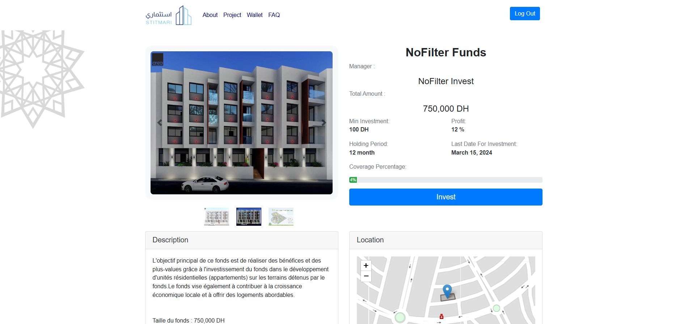
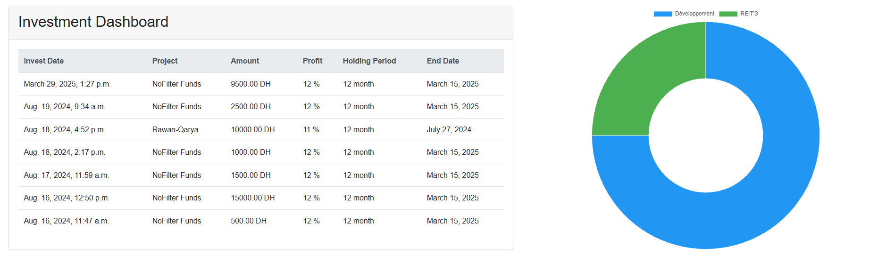
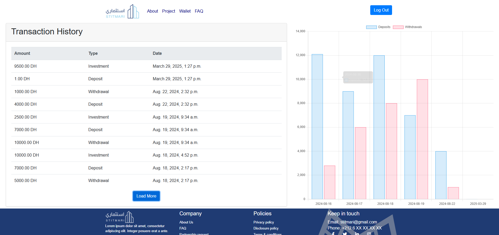

# STITMARI

**Explore real-estate projects and follow your investment activity in one place.**

STITMARI is a web platform project focused on real-estate investment in Morocco. It brings project information, user accounts, wallet-related pages and investment activity together in one website.

---

## Contents

- [About STITMARI](#about-stitmari)
- [Explore the platform](#explore-the-platform)
- [Project status](#project-status)
- [About this project](#about-this-project)

## About STITMARI

STITMARI is designed to make real-estate project information easier to explore. Visitors can browse projects and review the information presented for each opportunity. The website also includes account, wallet and investment-related areas for users.

## Explore the platform

### 1. Homepage

The homepage introduces STITMARI and gives visitors an overview of the platform.

### 2. Browse real-estate projects

The project listing page presents the real-estate projects available to explore.

### 3. View project details

Open a project to review the information provided about it, including its description, images and investment-related details.

### 4. View your wallet

The wallet area brings together wallet information and related account actions.

### 5. Follow investments

The investment area provides a view of investment-related information displayed by the platform.

### 6. Review transactions

The transactions page displays the transaction activity recorded in the account.

## Project status

STITMARI is presented as a software project and development build. The presence of a page or button does not necessarily mean that a real-world service is connected or ready for public use.

In particular, wallet and payment-related screens should not be interpreted as proof that real payments, deposits, withdrawals or investment payouts are processed. Any displayed investment figures or projected returns should not be considered guaranteed financial outcomes.

## About this project

STITMARI is built as a Django web application. Its code is organised into separate areas for user accounts, real-estate projects, wallet functionality and general website pages.

This repository documents the application and its interface. It is not an offer to sell investments or a guarantee of financial returns.

---

_STITMARI — a clearer way to explore real-estate project information._
